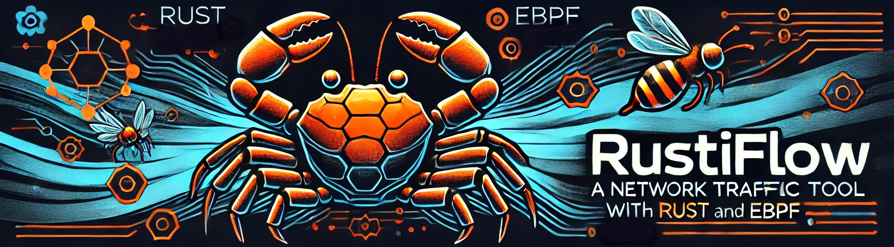
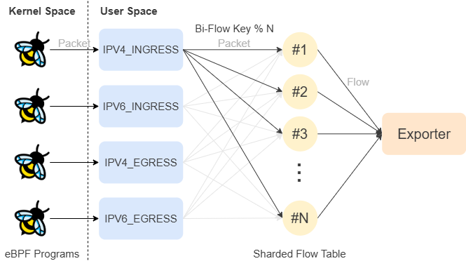
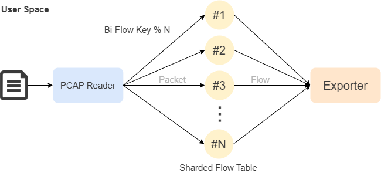

# RustiFlow: network flow feature extraction

RustiFlow reconstructs bidirectional network flows and extracts per-flow
features for intrusion detection research and dataset generation. It reads
pcap and pcapng files offline. On Linux it can also capture live traffic
through eBPF classifiers built with [Aya](https://aya-rs.dev/). Both modes feed
the same flow table, so their flow semantics match.

<a href="https://github.com/idlab-discover/RustiFlow/actions"></a>
<a href="https://idlab-discover.github.io/RustiFlow"> </a> <a href="https://github.com/idlab-discover/RustiFlow/blob/main/LICENSE">  </a>


## Quick start

```bash
rustiflow -f rustiflow pcap trace.pcap                            # writes output.parquet
rustiflow -f basic -o csv --header --export-path flows.csv pcap trace.pcap
sudo rustiflow -f cic --export-path live.parquet realtime eth0    # Ctrl-C flushes and finalizes
rustiflow -c config.toml pcap trace.pcap                          # settings from a config file
rustiflow                                                         # interactive TUI
```

## Feature sets

Select a set with `-f`. See the [wiki](https://github.com/idlab-discover/RustiFlow/wiki)
for the individual features.

| Set | Columns | Notes |
| --- | ---: | --- |
| `basic` | 10 | Flow key, timestamps, duration, and expiration cause |
| `cic` | 100 | CICFlowMeter-style |
| `cidds` | 10 | CIDDS-style |
| `nfstream` | 71 | NFStream-inspired |
| `unsw-nb15` | 47 | [UNSW-NB15-inspired](docs/unsw-nb15.md) |
| `rustiflow` | 203 | Everything, including TCP quality signals (duplicate ACKs, zero windows, close style), retransmissions, and IP version, scope, and path locality |
| `custom` | — | Your own; start from [`custom_flow.rs`](rustiflow/src/flows/custom_flow.rs) |

`--drop-contaminant-features` removes raw identifiers such as exact IPs and
ports, so a model cannot learn shortcuts from them.

### UNSW-NB15

```bash
rustiflow -f unsw-nb15 -o csv --header --export-path unsw.csv pcap trace.pcap
```

Use `features = "UnswNb15"` in TOML. The profile exports the 47 feature
columns from the full dataset schema. The clean projection has 39 columns.
Offline capture provides HTTP and FTP metadata for supported plaintext
sessions. Live capture provides connection history and header-derived fields.
See the [feature definitions and compatibility notes](docs/unsw-nb15.md).

## Output

| `-o` | Result |
| --- | --- |
| `parquet` (default) | Typed, Snappy-compressed Apache Parquet. Without `--export-path` it writes `output.parquet` and refuses to overwrite an existing one. An explicit path is overwritten. |
| `csv` | CSV file at `--export-path`. Add `--header` for a header row. |
| `print` | Console output. `--header` applies. |

Parquet embeds the feature names and types, even for empty captures. Fields
shown as UTC dates in CSV are UTC microsecond timestamps in Parquet. Sorted
offline exports are deterministic across runs and thread counts.

## Command-line reference

`rustiflow --help` and `rustiflow <command> --help` give the full text.

| Option | Default | Meaning |
| --- | --- | --- |
| `-f, --features` | required without `-c` | Feature set |
| `-c, --config-file` | | Load settings from a TOML file |
| `--active-timeout` | 3600 s | Maximum flow lifetime |
| `--idle-timeout` | 120 s | Maximum gap without packets |
| `--early-export N` | off | Cumulative snapshot every N s per flow; see [Early export](#early-export) |
| `--expiration-check-interval` | 60 s | How often the flow table is swept |
| `--threads` | realtime 12, pcap 5 | Flow-table workers, capped at the logical CPU count |
| `-o, --output` | `parquet` | `parquet`, `csv`, or `print` |
| `--export-path` | `output.parquet` | Output file |
| `--header` | off | Header row for CSV and console output |
| `--drop-contaminant-features` | off | Omit raw identifiers |
| `--packet-graph` | off | Live packet graph during realtime file exports |

Commands:

- `pcap <path>` reads a classic pcap or pcapng file.
- `realtime <interface> [--ingress-only] [--promiscuous]` captures live traffic.
- `replay-bench` benchmarks the realtime userspace pipeline; see [Replay benchmark](#replay-benchmark).

## Flow semantics

### Packet coverage

| Layer | Offline pcap | Realtime eBPF |
| --- | --- | --- |
| Link | Ethernet, Linux cooked capture, 802.1Q VLAN | Ethernet |
| Network | IPv4, IPv6 with extension headers | IPv4, IPv6 with extension headers |
| Transport | TCP, UDP, ICMP, ICMPv6 | TCP, UDP, ICMP, ICMPv6 |

Both modes skip non-initial IPv4 and IPv6 fragments, which lack a transport
header. Initial fragments are used, and nothing is reassembled. IPv6 ESP is
skipped because its payload is encrypted. Timestamp and packet-length sources
can differ slightly between offline and realtime input.

### Capture files

RustiFlow reads files with a pure-Rust reader and reproduces libpcap's default
microsecond behavior. A file that ends inside a record is read up to that
record, with a warning. A corrupt record, an invalid timestamp fraction, or an
out-of-range timestamp stops the read with an error naming the file offset.
Earlier packets are still exported.

### TCP lifecycle

- A flow first seen as a SYN-ACK takes that packet's destination as the
  forward endpoint. Otherwise the first packet's source is forward.
- Handshake and FIN acknowledgments tolerate reordering, using wrapping TCP
  sequence arithmetic.
- `four_way_fin` includes three-segment closes (FIN, FIN|ACK, ACK).
  `simultaneous_fin` requires both FINs to carry ACKs that do not cover the
  peer's FIN.
- Packets that arrive after a flow was exported start a new flow, so observed
  packet counts are preserved. This includes retransmitted FINs.
- Retransmission counters keep at most 1,024 merged sequence ranges per
  direction and evict the lowest first. Retransmissions that overlap only
  evicted history can be missed. This is not full stream reassembly.

### Timing

- Durations use the earliest and latest observed timestamps.
- IATs follow processing order against a nondecreasing reference. A late packet
  adds a zero interval. Chronological order is not reconstructed.
- Idle periods are gaps above five seconds between packets of the same flow.
  Trailing silence before expiration or shutdown is not counted.
- Bulks need at least four nonzero-length packets, and a gap of more than one
  second ends one. Durations are fractional milliseconds and rates are bytes
  per second. A bulk with identical timestamps exports a rate of zero, which
  shows up as a positive bulk count with zero duration.
- These rules apply to both offline and realtime input.

### Early export

`--early-export N` emits cumulative snapshots of long-lived flows before their
final row:

- Snapshots follow a fixed per-flow schedule: first packet + N, + 2N, and so
  on. The first packet at or after a boundary triggers one snapshot. A quiet
  flow gets none until it expires.
- Each snapshot is closed like a final row but has `flow_expire_cause` `None`.
  The flow stays open, and its final row repeats everything.
- `N` must be at least 1 and smaller than `--active-timeout`.

## Realtime capture

Realtime capture is Linux-only and needs root or `CAP_BPF`, `CAP_NET_ADMIN` and
`CAP_PERFMON`. It attaches tc classifiers for ingress and, unless
`--ingress-only` is given, egress. It detaches them on exit.



Ctrl-C detaches the capture hooks, drains queued events, and finalizes the
export. A busy capture can take time to finish writing. RustiFlow reports an
error if the decoded event count differs from the kernel submission count.
When updating a manual installation, update the executable before replacing
the eBPF objects.

For a read-only Linux interface inventory, run
`python3 docs/profiling/nic_inventory.py INTERFACE` in the capture network
namespace (Python 3.9+, iproute2 and ethtool with JSON support). The standalone
probe prints JSON with each query's source. Nulls and omitted driver attributes
mean unknown. `reported_speed_bps` converts the ethtool or sysfs speed from
Mb/s to bit/s. A veth speed is a software device readback. Ethernet lane count
and PCIe link width appear separately. The probe preserves GET errors alongside
available data and can read sysfs when either optional utility is missing.

### Promiscuous capture

A physical NIC drops unicast frames addressed to other MAC addresses. On a tap,
SPAN/mirror port, or backbone link, pass `--promiscuous`. RustiFlow joins a
promiscuous membership on a packet socket rather than setting the interface's
`PROMISC` flag. The kernel releases the membership when RustiFlow exits, even
on a crash, and a `promisc on` set by an operator stays in place. This needs
`CAP_NET_RAW` and the `AF_PACKET` socket family. Config files do not store the
flag, so pass it on the command line or in `RUSTIFLOW_REALTIME_ARGS`.

### Tuning and experiments

| Variable | Effect |
| --- | --- |
| `RUSTIFLOW_EBPF_DIR` | Directory holding the eBPF objects |
| `RUSTIFLOW_REALTIME_SHARD_BATCH_SIZE` | Shard batch capacity in packets for realtime capture and replay (default: 512) |
| `RUSTIFLOW_REALTIME_SHARD_QUEUE_CAPACITY`, `RUSTIFLOW_REALTIME_SOURCE_DISPATCH_QUEUE_CAPACITY` | Pipeline queue capacities |
| `RUSTIFLOW_REALTIME_STATS=1` | Per-source drain and dispatch timing |
| `RUSTIFLOW_EXPERIMENT_RING_BYTES` | Realtime event-map data bytes, in decimal as `IPv4_per_map,IPv6_per_map,total_cap`. Unset uses the sizes in the selected eBPF object. |
| `RUSTIFLOW_EXPERIMENT_*` | Opt-in experiments (XDP ingress, single tc classifier, staged lookup, and others) and switches for on-by-default optimizations |

[docs/profiling/experiments.md](docs/profiling/experiments.md) lists every
experiment switch, its default, and its measured effect.

On Linux, each family has eight event rings per capture direction. Explicit
sizes must be powers of two of at least one host page. RustiFlow checks the
total against the supplied cap before loading a classifier. The cap covers
event-ring data only. Map metadata, flow tables and export need additional
memory. Smaller rings can drop packets during reader stalls.

For example, the following command calculates a setting on the capture host
for a 120 ms stall. Supply peak packets/s in the busiest **software ring of
each family**. For two-hook capture, use the higher peak across the two hooks
for each family and omit `--ingress-only`.

```bash
python3 docs/profiling/size_event_rings.py --ingress-only --cap-mib 65 \
    --stall-ms 120 --ipv4-hot-pps 1350000 --ipv6-hot-pps 10000
# 8388608,131072,68157440
```

Set `RUSTIFLOW_EXPERIMENT_RING_BYTES` to the printed value for the capture.
The calculator reports an error if the requested burst exceeds the budget.

## Configuration file and TUI

```toml
[config]
features = "Nfstream"
active_timeout = 3600
idle_timeout = 120
early_export = 10               # optional
expiration_check_interval = 60
threads = 8                     # optional

[output]
output = "Parquet"              # Parquet, Csv, or Print
export_path = "flows.parquet"
header = false
drop_contaminant_features = true
packet_graph = false
```

Running `rustiflow` without arguments opens a TUI that edits and saves these
files. Use the saved file with `rustiflow -c <file> pcap ...` or
`rustiflow -c <file> realtime <interface>`.


## Installing a release

Every release channel installs the same bundle,
`rustiflow-<version>-x86_64-linux.tar.gz`. It contains the binary, both eBPF
objects, a systemd template unit, example configuration, `install.sh`, a build
`MANIFEST`, and `SHA256SUMS`. Bundles need x86_64 Linux with glibc 2.36 or
newer (Debian bookworm, Ubuntu 24.04 and later) and an x86-64-v3 CPU (Intel
Haswell, AMD Zen, or newer).

```bash
tar -xzf rustiflow-<version>-x86_64-linux.tar.gz
sudo sh rustiflow-<version>-x86_64-linux/install.sh            # into /usr/local
sudo sh rustiflow-<version>-x86_64-linux/install.sh --prefix /opt/rustiflow
cd /usr/local && sha256sum -c share/rustiflow/INSTALLED.sha256  # verify later
```

The installer checks the bundle and refuses an unsupported CPU. It never writes
to `/etc`. The binary looks for its eBPF objects in `<prefix>/lib/rustiflow/`,
or in `RUSTIFLOW_EBPF_DIR`.

### Debian package

`debian/` repackages a bundle into `/usr` without rebuilding. The bundle
version must match `debian/changelog`, and the bundle must be built on
bookworm.

```bash
RUSTIFLOW_BUNDLE=/path/to/rustiflow-<version>-x86_64-linux.tar.gz dpkg-buildpackage -b -uc -us
sudo apt install ../rustiflow_<version>-1_amd64.deb
```

### systemd service

`rustiflow@<interface>.service` captures on one interface with only the
capabilities it needs. It is installed but not enabled:

```bash
sudo install -D -m 0644 /usr/share/rustiflow/config.toml.example /etc/rustiflow/eth0.toml
sudo install -D -m 0644 /usr/share/rustiflow/environment.example /etc/rustiflow/eth0.env  # optional
sudo systemctl daemon-reload
sudo systemctl enable --now rustiflow@eth0.service
```

Set extra realtime flags, such as `--promiscuous`, with
`RUSTIFLOW_REALTIME_ARGS` in the `.env` file. Relative export paths resolve
under `/var/lib/rustiflow/<interface>/`. For a `/usr/local` install, use
`/usr/local/share/rustiflow/...`.

### Container

Docker Desktop is not supported, because its `--network host` attaches to a VM
rather than the host.

```bash
docker build -t rustiflow .                     # Ubuntu 24.04 runtime
docker build --target slim -t rustiflow:slim .  # Debian bookworm-slim runtime
docker build --build-context bundle=target/dist -t rustiflow .  # from an existing bundle

docker run --rm -v "$PWD:/app" rustiflow -f basic -o print pcap /app/trace.pcap
docker run --rm --privileged --network host -v "$PWD:/app" rustiflow \
  -f cic --export-path /app/live.parquet realtime enp5s0
```

### Building a release bundle

The canonical bundle comes from the Dockerfile's bookworm stage:

```bash
docker build --target bundle \
  --build-arg RUSTIFLOW_COMMIT=$(git rev-parse HEAD) \
  --build-arg SOURCE_DATE_EPOCH=$(git log -1 --format=%ct) \
  --output type=local,dest=target/dist .
```

`cargo xtask dist` builds the same layout on the current host into
`target/dist/`. The result runs only on hosts with the same or newer glibc.
`cargo xtask install [--prefix DIR]` installs it. `--target-cpu` (default
`x86-64-v3`) sets the CPU the binary requires. `native` tunes for the build
host, and a lower level such as `x86-64-v2` suits older CPUs. In the container
build, pass `--build-arg RUSTIFLOW_TARGET_CPU=<cpu>`.

## Development

### Prerequisites

- Rust via [rustup](https://rustup.rs). `rust-toolchain.toml` pins the
  userspace toolchain. The eBPF crates use nightly with `rust-src`:
  `rustup toolchain install nightly --component rust-src`.
- `bpf-linker` 0.12.0. Use the upstream prebuilt binary, because building it
  with `cargo install` needs a matching system LLVM:

  ```bash
  curl -fL https://github.com/aya-rs/bpf-linker/releases/download/v0.12.0/bpf-linker-x86_64-unknown-linux-musl.tar.zst \
    | tar --zstd -xf - -C "$HOME/.cargo/bin"
  ```

  Other platforms: see the [upstream releases](https://github.com/aya-rs/bpf-linker/releases/tag/v0.12.0).

### Build, run, test

```bash
cargo xtask ebpf-ipv4 && cargo xtask ebpf-ipv6   # eBPF objects
cargo build                                       # userspace
cargo xtask run -- [OPTIONS] <COMMAND>            # build everything and run
cargo test -p rustiflow
```

`cargo xtask` enforces the committed lockfiles. Pass `--locked` to direct Cargo
commands for the same guarantee. Set `RUST_LOG=info` or `RUST_LOG=debug` for
logs.



### Replay benchmark

`replay-bench` measures the realtime userspace pipeline without root, traffic,
or eBPF. It drains synthetic eBPF events through the same per-source
batching, dispatch, shard flow tables, and exporter as `realtime`:

```bash
cargo build --release
./target/release/rustiflow -f rustiflow --export-path /dev/null replay-bench --packets 50000000 --flows 100000
# Replay: packets=50000000 threads=12 wall_s=3.251 mpps=15.378 cpu_s=43.531 cpu_ns_per_packet=870.6 cpus_busy=13.39
```

- `mpps` covers the first replayed event through writer close, including the
  final export of all open flows, so use far more packets than flows.
- `cpu_ns_per_packet` is whole-process CPU time over that interval. Event
  generation is excluded.
- Events are spread uniformly over `--flows` flows. Even flows are TCP and odd
  flows UDP. No flow terminates. Each flow maps to one of `--sources` evenly
  balanced sources.
- Other options: `--drain-burst`, `--payload-bytes`, `--virtual-pps` (sets the
  virtual time seen by timeouts and early export), and `--ipv6`.
- All global options and `RUSTIFLOW_REALTIME_*`, `RUSTIFLOW_EXPERIMENT_*`, and
  `RUSTIFLOW_PROFILE_*` variables apply as in `realtime`.

### Profiling

`cargo build --profile profiling --features profiling` keeps symbols for `perf`
and enables `RUSTIFLOW_PROFILE_FLAMEGRAPH=<file.svg>`. Other hooks are
`RUSTIFLOW_PROFILE_RESOURCE_SUMMARY=1` and
`RUSTIFLOW_PROFILE_EXPORT_BREAKDOWN=1`. The [profiling guide](docs/profiling/README.md)
covers the workloads and scripts, and the
[engineering notes](docs/engineering-notes.md) record design decisions and
measurements.

With the sibling `concap` repository and a Kubernetes cluster,
`./scripts/concap_smoke.sh ../concap nmap-tcp-syn-version.yaml` runs a small
end-to-end capture and reprocesses it with the local checkout.
