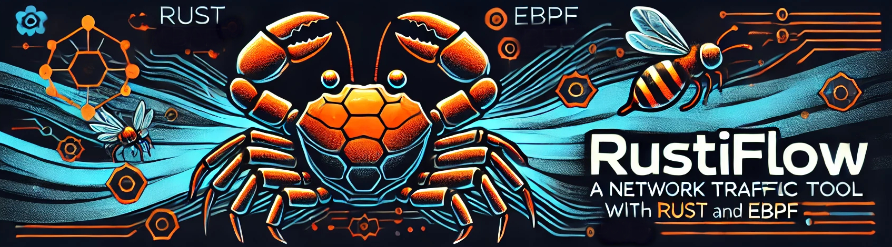
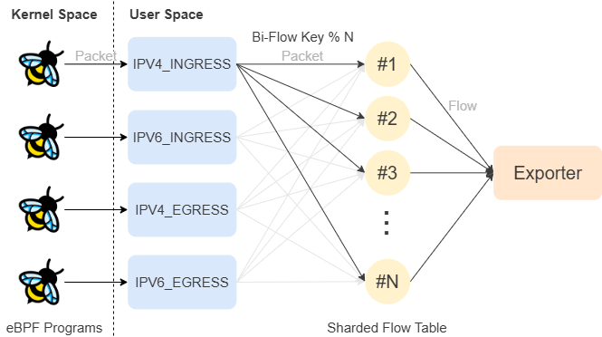
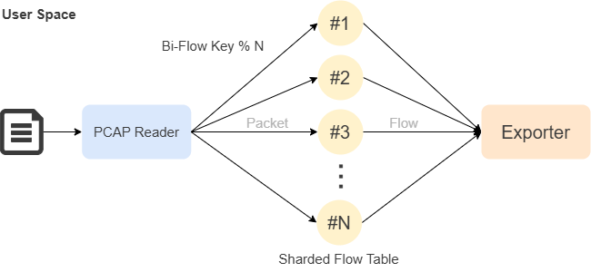

# A Network Traffic Feature Extraction Tool

##  Overview

This tool is engineered for robust and efficient feature extraction, particularly for applications such as network intrusion detection systems, among others. Leveraging Rust language and eBPF, it excels in processing high volumes of network traffic with remarkable speed and throughput. (When your traffic is already captured, don't worry! It also has a build in pcap reader which is also amazingly fast.) With various pre-defined feature sets and the ability to create custom feature sets, RustiFlow offers a versatile solution for network security applications.

<a href="https://github.com/idlab-discover/RustiFlow/actions"></a>
<a href="https://idlab-discover.github.io/RustiFlow"> </a> <a href="https://github.com/idlab-discover/RustiFlow/blob/main/LICENSE">  </a>


##  Key Features

- **High Throughput:** Utilizes Rust and the [Aya](https://aya-rs.dev/) library for eBPF program compilation and execution, ensuring exceptional performance and resource efficiency.
- **Versatile Feature Sets:** Offers a variety of pre-defined feature sets (flows) and the flexibility to create custom feature sets tailored to specific requirements. An example of the custom flow is shown [here](https://github.com/idlab-discover/RustiFlow/blob/main/rustiflow/src/flows/custom_flow.rs).
- **Pcap File Support:** Facilitates packet analysis from pcap files, compatible with both Linux and Windows generated files.
- **Diverse Output Options:** Features can be outputted to the console, a CSV file, or other formats with minimal effort.
- **Richer TCP Quality Signals:** The RustiFlow feature set exports duplicate ACK counts, zero-window observations, and TCP close style in addition to the existing lifecycle and retransmission fields.
- **Endpoint-Aware IP Context:** The RustiFlow feature set exports `ip_version`, endpoint IP scope, and coarse `path_locality` derived from normalized addresses without expanding the eBPF event payload.

## Feature sets

See the [wiki](https://github.com/idlab-discover/RustiFlow/wiki) for the different feature sets available.

Bulk durations are exported in milliseconds, including fractional milliseconds.
Bulk rates are packet bytes per second, measured using integer microsecond timestamps.
A bulk needs at least four nonzero-length packets; an idle gap greater than exactly
one second ends it. Packet-byte accounting and direction-switch rules are unchanged.
A bulk with identical timestamps has an undefined rate exported as zero, following
the shared rate convention. Positive bulk count with zero total duration identifies
that fallback; it must not be interpreted as measured zero throughput.

## Supported Packet/Header Coverage

RustiFlow currently extracts flows from the following protocol/header combinations:

| Layer | Offline pcap | Realtime eBPF |
| --- | --- | --- |
| Link | Ethernet, Linux cooked capture, 802.1Q VLAN | Ethernet |
| Network | IPv4, IPv6 | IPv4, IPv6 |
| IPv6 extras | Extension headers supported before transport parsing | Extension headers supported before transport parsing |
| Transport | TCP, UDP, ICMP, ICMPv6 | TCP, UDP, ICMP, ICMPv6 |

Notes:

- Realtime support is Linux-only.
- Offline and realtime aim to expose the same flow semantics, but timestamp and packet-length sources can differ slightly.
- Realtime VLAN parsing is not implemented yet.

##  Architecture

### Realtime processing



### Offline PCAP processing



##  Using the release binary:

Copy the rustiflow binary that you can find in this repo in releases to a location of your choice or to the `/usr/local/bin` folder.
If it does not have the right permissions, you can run the following command:

```bash
chmod +x /path/to/rustiflow
```

### Using commands:

You can then run the binary with the following commands displayed on the [help menu](#usage-instructions).

### Using the tui interface:

If you want a more graphical interface, you can use the tui interface by just running `rustiflow` without any arguments. This will open a field where you can enter a configuration file you want to edit or you can choose to start new. After that, the following interface will show up:


> **NOTE:** When using the save button, you will be prompted for a filename. You can reuse this file with following command:

```bash
rustiflow --config-file <filename> realtime <interface> [--only-ingress]
```

```bash
rustiflow -c <filename> pcap <path to pcap file>
```

> After saving the configuration file, you can safely reset without changing the configuration file.

### Using the configuration file:

This is an example of a configuration file that you can use to run the tool with the `--config-file` option.

```toml
[config]
features = "CIDDS"
active_timeout = 522
idle_timeout = 885855
early_export = 25
expiration_check_interval = 0

[output]
output = "Csv"
export_path = "path/to/output.csv"
header = false
drop_contaminant_features = true
```

Example 2:

```toml
[config]
features = "Nfstream"
active_timeout = 3600
idle_timeout = 120
early_export = 10
expiration_check_interval = 60
threads = 8

[output]
output = "Print"
header = true
drop_contaminant_features = false
```

For realtime CSV exports, the live packet graph is now off by default so the
standard CLI path keeps the best throughput-oriented behavior. Enable it only
when you want the graph:

```toml
[output]
packet_graph = true
```

or with:

```bash
rustiflow ... -o csv --export-path out.csv --packet-graph realtime <interface>
```

##  Using the Container:

Make sure that you don't use docker desktop and that you don't have it installed on your machine. If you have this setup, it will not work as intended as the `--network host` will not link the container to the host network, but to the network of a VM that docker desktop uses.

- **Build the Container**:
  ```bash
  docker build -t rustiflow .
  ```
- **Run the Container**:
  ```bash
  docker run --rm --network host -v /path/on/host:/app rustiflow [ARGS]
  ```
  Run it with the `--privileged` flag if you want to capture traffic in real-time.
- **Example**:
  ```bash
  docker run --rm --network host -v /home/user/pcap:/app rustiflow \
    -f basic \
    -o print \
    pcap /app/pcap.pcap
  ```
  ```bash
  docker run --rm --privileged --network host -v /home/user/output:/app rustiflow \
    -f cic \
    -o csv \
    --export-path /app/output.csv \
    realtime enp5s0
  ```

Notes:

- The current CLI uses flags such as `-f basic` and `-o csv`; the older
  positional examples are no longer correct.
- Realtime capture in a container still depends on Linux host support for eBPF
  and `tc`, so `--privileged --network host` remains the practical baseline for
  local testing.

##  Installation Guide for development

### Prerequisites:

- **libpcap-dev**:
  ```sh
  sudo apt install libpcap-dev
  ```
- **Rust Installation**:
  ```bash
  curl --proto '=https' --tlsv1.2 -sSf https://sh.rustup.rs | sh
  ```
- **Nightly Rust Toolchain**:
  ```bash
  rustup install stable
  rustup toolchain install nightly --component rust-src
  ```

### bpf Linker Installation:

Use the upstream prebuilt binary. Building current `bpf-linker` releases with
`cargo install` requires a matching system LLVM installation; Rust's
`llvm-tools-preview` component alone is not sufficient.

- **For Linux x86_64**:
  ```bash
  sudo apt install zstd # Debian/Ubuntu; use your distribution's package manager elsewhere
  curl -fL --retry 3 https://github.com/aya-rs/bpf-linker/releases/download/v0.11.1/bpf-linker-x86_64-unknown-linux-musl.tar.zst -o /tmp/bpf-linker.tar.zst
  mkdir -p "$HOME/.cargo/bin"
  tar --zstd -xf /tmp/bpf-linker.tar.zst -C "$HOME/.cargo/bin"
  rm /tmp/bpf-linker.tar.zst
  bpf-linker --version
  ```
- **For macOS/Linux (Other Architectures)**: choose the matching archive from
  the [upstream releases](https://github.com/aya-rs/bpf-linker/releases/tag/v0.11.1),
  or follow the [upstream installation guide](https://github.com/aya-rs/bpf-linker#installation).
- **Ubuntu 20.04 LTS Specific**:
  ```bash
  sudo apt install linux-tools-5.8.0-63-generic
  export PATH=/usr/lib/linux-tools/5.8.0-63-generic:$PATH
  ```

##  Building the Project

`cargo xtask` enforces the committed lockfiles for the helper and every build it
launches. If a manifest change requires a lockfile update, update and commit the
affected lockfile explicitly before rebuilding. Direct Cargo commands need
`--locked` for the same enforcement.

- **eBPF Programs**:
  ```bash
  cargo xtask ebpf-ipv4
  cargo xtask ebpf-ipv6
  ```
- **User Space Programs**:
  ```bash
  cargo build
  ```
- **With flamegraph profiling** (Linux only, pulls in pprof; enables
  `RUSTIFLOW_PROFILE_FLAMEGRAPH=<file.svg>`):
  ```bash
  cargo build --release --features profiling
  ```

## Fragmented and encrypted packets

Offline and realtime capture skip non-initial IPv4 and IPv6 fragments because
those fragments do not contain the original transport header. Initial fragments
remain eligible for extraction; RustiFlow does not reassemble fragmented packets.
IPv6 AH uses its four-byte length units. IPv6 ESP is skipped because its encrypted
payload cannot be parsed as a transport header.

## TCP flow lifecycle

A flow first observed as SYN-ACK uses that packet's destination as the forward
endpoint. Other flows use the first observed packet's source. Handshake and FIN
acknowledgments tolerate reordered observations using TCP sequence arithmetic.
The `four_way_fin` close style includes a three-segment FIN, FIN|ACK, ACK close;
`simultaneous_fin` requires both FIN packets to carry ACKs that do not acknowledge
the peer's FIN. Packets observed after a completed flow was exported start a new
flow, including retransmitted FINs. This preserves observed packet counts.

Retransmission counters retain at most 1,024 merged TCP sequence ranges per
direction. The lowest sequence ranges are evicted first; retransmissions that
overlap only evicted history may be missed. Sequence numbers are unwrapped across
32-bit rollover, assuming observations are less than half the sequence space
apart. These counters do not perform full TCP stream reassembly.

## Out-of-order packet timing

Flow and directional durations use the earliest and latest observed packet
timestamps. IAT statistics follow processing order with a nondecreasing timestamp
reference: late packets contribute a zero interval and do not move that reference
backwards. Active/idle periods also advance monotonically; completed periods are
not reconstructed. Bulk durations retain the timestamp bounds of their current
bulk. These bounded streaming statistics do not reconstruct chronological IATs.
The same rules apply to offline and realtime input.

## Running the Project in dev mode

```bash
cargo xtask run -- [OPTIONS] <COMMAND>
```

##  Usage Instructions

### Command Help:

```bash
rustiflow help
```

```bash
Usage: rustiflow [OPTIONS] <COMMAND>

Commands:
  realtime      Real-time feature extraction
  pcap          Feature extraction from a pcap file
  replay-bench  Benchmark the realtime userspace pipeline with synthetic eBPF events (no capture, no root needed). Prints throughput and CPU time per packet
  help          Print this message or the help of the given subcommand(s)

Options:
  -c, --config-file <CONFIG_FILE>
          Configuration file path

  -f, --features <FEATURES>
          The feature set to use (required if no config file is provided)

          Possible values:
          - basic:     A basic flow that stores the basic features of a flow
          - cic:       Represents the CIC Flow, giving 90 features
          - cidds:     Represents the CIDDS Flow, giving 10 features
          - nfstream:  Represents a nfstream inspired flow, giving 71 features
          - rustiflow: Represents the Rusti Flow, giving 203 features
          - custom:    Represents a flow that you can implement yourself

      --active-timeout <ACTIVE_TIMEOUT>
          The maximum time a flow is allowed to last in seconds (optional)

          [default: 3600]

      --idle-timeout <IDLE_TIMEOUT>
          The maximum time with no packets for a flow in seconds (optional)

          [default: 120]

      --early-export <EARLY_EXPORT>
          Export a cumulative snapshot of each open flow every N seconds after its first packet (optional; must be at least 1 and smaller than the active timeout). Snapshots are triggered by packets and have flow_expire_cause None

      --expiration-check-interval <EXPIRATION_CHECK_INTERVAL>
          Interval (in seconds) for checking and expiring flows in the flowtable. This represents how often the flowtable should be scanned to remove inactive flows

          [default: 60]

      --threads <THREADS>
          The numbers of threads to use for processing packets (optional) (default: realtime uses 12, capped at the number of logical CPUs; pcap uses 5; maximum number of logical CPUs)

      -o, --output <OUTPUT>
              Output method (required if no config file is provided)

              Possible values:
              - print: The output will be printed to the console
              - csv:   The output will be written to a CSV file

          --export-path <EXPORT_PATH>
              File path for output (used if method is Csv)

          --packet-graph
              Enable the realtime packet graph for CSV exports
              [default: false]

          --header
              Whether to export the feature header

          --drop-contaminant-features
              Whether to drop contaminant features

      -h, --help
              Print help (see a summary with '-h')

      -V, --version
              Print version

```

### Early export

`--early-export N` (or `early_export = N` in the configuration file) emits
periodic snapshots of long-lived flows before their final export:

- Snapshots fall on a fixed per-flow schedule: first packet + N, + 2N, ...
  The first packet at or after a boundary exports one snapshot, so a flow
  produces about `duration / N` snapshots rather than one per packet.
  Boundaries that pass without packets are skipped, and a flow that goes quiet
  gets no further snapshots until it expires.
- Each snapshot is cumulative: it covers the flow from its first packet up to
  and including the triggering packet, with the same columns as a final row.
- Snapshots are closed like a final export (open bulks and the current active
  period are counted, TCP close style reflects the FINs seen so far) but keep
  `flow_expire_cause` `None`. Final rows always carry a real expiration cause.
- The flow itself stays open; its final row repeats everything in the
  snapshots.
- `N` must be at least `1` and smaller than `--active-timeout`. Omit the flag to
  disable early export.

### Replay benchmark

`replay-bench` measures the realtime userspace pipeline without capturing
traffic or loading eBPF programs, so it needs no root and no traffic generator.
It generates synthetic eBPF events in memory, then drains them through the same
per-source batching, dispatch, shard flow tables and CSV export as `realtime`:

```bash
cargo build --release
./target/release/rustiflow -f rustiflow -o csv --export-path /dev/null --threads 12 \
  replay-bench --packets 50000000 --flows 100000
```

It prints one result line on stderr:

```text
Replay: packets=50000000 threads=12 wall_s=3.251 mpps=15.378 cpu_s=43.531 cpu_ns_per_packet=870.6 cpus_busy=13.39
```

- `mpps` is events per second of wall time, from the first replayed event until
  the output writer closes. It includes the final export of every open flow, so
  use far more packets than flows.
- `cpu_ns_per_packet` is the CPU time of the whole process (all tokio workers)
  over the same interval, divided by the packet count. Event generation is
  excluded.
- Events are spread uniformly at random over `--flows` flows. Even flows are
  TCP with in-order data segments in both directions, odd flows are UDP, and
  no flow terminates. All events of a flow go to one of `--sources` sources,
  which are evenly balanced, unlike real eBPF queue selection.
- `--virtual-pps` spaces event timestamps, which sets the virtual time seen by
  timeouts, expiration checks and `--early-export`.
- The feature set, `--threads`, timeouts, early export, output options and the
  `RUSTIFLOW_REALTIME_*` and `RUSTIFLOW_PROFILE_*` environment variables apply
  as for `realtime`. Events take 40 (IPv4) or 72 (IPv6) bytes of memory
  each.

## Logging in both development or using the binary

### Development

```bash
RUST_LOG=info cargo xtask run --
```

Run the focused Rust test suite with:

```bash
cargo test -p rustiflow
```

If you also have the sibling `concap` repository and a reachable Kubernetes cluster,
you can run a tiny ConCap-backed smoke check and then reprocess the downloaded pcap
with your current local RustiFlow checkout:

```bash
./scripts/concap_smoke.sh ../concap nmap-tcp-syn-version.yaml
```

### Binary

```bash
sudo RUST_LOG=info rustiflow
```

**Note:** For specific logging levels, adjust `RUST_LOG` to `error` for error messages, and `debug` for debug messages. If you don't want any additional logs, just remove `RUST_LOG=info`.

---
